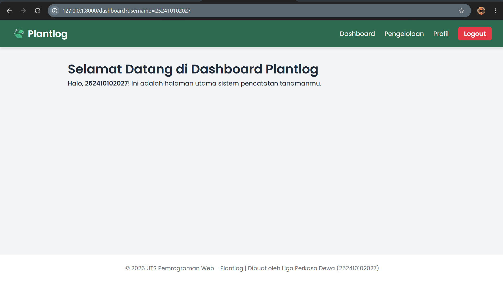

# 🌱 PlantLog

### Website Pengelolaan Tanaman

## 📌 Deskripsi
PlantLog merupakan aplikasi berbasis web yang dibuat untuk membantu pengguna dalam mengelola dan memantau data tanaman dengan lebih mudah dan terstruktur.

Project ini dibuat untuk memenuhi tugas UTS Pemrograman Web Genap 2025/2026.

## 🛠️ Teknologi
- PHP
- Laravel
- MySQL
- HTML
- CSS
- JavaScript

## ✨ Fitur
- Dashboard
- Pengelolaan data tanaman
- Penambahan data tanaman
- Pengeditan data tanaman
- Penghapusan data tanaman
- Profil pengguna

## 📸 Screenshot Website

### Dashboard

## 👨‍💻 Identitas Pembuat
- Nama: Liga Perkasa Dewa
- NIM: 252410102027
- Mata Kuliah: Pemrograman Web
